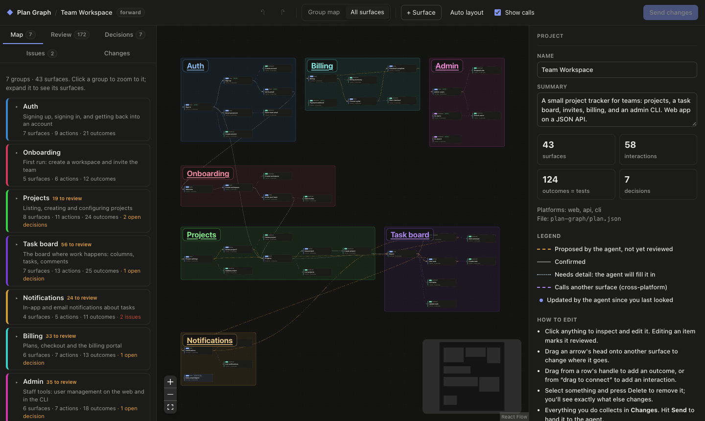

# Plan Graph

[](https://github.com/FenixSC2/plan-graph/actions/workflows/ci.yml) [](LICENSE)

**See and edit every decision your AI coding agent is about to make, before it writes any code. Make a big codebase readable at a glance.**

When an agent builds an app, it makes hundreds of small choices you never asked about. Where does the
button go after a successful save? What does the error say? Which exit code means "not found"? Is the
redirect a 301 or a 302? Most of these choices are fine and a few are wrong, and you only find the wrong
ones by reading the code.

Plan Graph is an [agent skill](https://docs.claude.com/en/docs/claude-code/skills) that puts these
choices in front of you first. The agent drafts your app as a graph: every page, modal, CLI command and
API endpoint, every action on it, and where each outcome leads. Every assumption is written down as a
decision, with the alternatives the agent considered. You review it in a local graph editor, change
what you disagree with and press **Send**. The agent gets your edits as exact operations, not prose,
then builds from the plan with one test per outcome.


<sub>One review round on the bundled example plan, a link shortener with a web UI, an HTTP API and a CLI in one graph. The agent step is the real <code>plan.ts apply</code> → follow-on edits → <code>plan.ts done</code>, not a mock.</sub>

## Why

- **Readable at any size.** A wall of text stops working past a few dozen screens; a map doesn't.
  Large plans open on a **group map**: one card per area of the app (Auth, Checkout, Admin API…)
  with what it contains, how the areas connect, and what still needs review. Click a group to
  zoom into it. In the full graph, groups are labelled regions you can read at any zoom.
- **No silent assumptions.** Anything a reasonable developer could have done differently, and you would
  notice, is a *decision* with alternatives, a rationale and an impact level. You can switch to an
  alternative in one click.
- **Edits are unambiguous.** Dragging an arrow to a different screen becomes
  `update web.home.save.ok: to = web.dashboard`. The agent can't misread that.
- **Tests come from the plan.** Every outcome is a test case, and its ID goes in the test name
  (`web.home.shorten.invalid: …`), so you can check that every case is covered.
- **Web, CLI and API in one graph.** A web form *calls* an API endpoint, and an API miss can land on a
  web 404 page. Each platform has a profile with its own checklist of decisions (exit codes and
  stdout vs. stderr for CLIs, error body shape and pagination for APIs, loading, empty and error
  states for pages).
- **Works on existing code too.** Point it at a codebase and it maps the routes, pages and commands
  that already exist, grouped by area. It records the decisions the code makes without stating them,
  and flags dead routes, missing error handling and inconsistent responses. On an unfamiliar
  project, that map is the fastest way in.

## Install

You need **Node 22.12 or newer**.

### Claude Code plugin (recommended)

In Claude Code, run:

```
/plugin install plan-graph --marketplace FenixSC2/plan-graph
```

On Claude Code versions older than 2.1.275, add the marketplace first:

```
/plugin marketplace add FenixSC2/plan-graph
```

```
/plugin install plan-graph@plan-graph
```

The skill is available from your next session. The first time the editor starts, the agent runs
`npm install` for it. To get new versions, run `/plugin update plan-graph@plan-graph`.

### As a plain skill

This works with Claude Code or any other agent that loads `SKILL.md` skills from a folder. Clone
the repo into your skills folder and install the editor's dependencies:

```bash
git clone https://github.com/FenixSC2/plan-graph ~/.claude/skills/plan-graph
```

```bash
npm install --prefix ~/.claude/skills/plan-graph/gui
```

To install it for one project only, clone it into `.claude/skills/plan-graph` inside that project
instead. To update it later, run `git pull` in that folder.

## Use it

You don't have to mention the skill. Describe what you want to build, or ask for an existing project
to be mapped, and the agent picks it up:

> I'm building a CLI called `tidy` that cleans up old git branches across all my repos. Before I write
> it, can we nail down every command, flag, what it prints and its exit codes?

> We're adding team invites to our Next.js app. Show me every screen and endpoint this touches, and
> what happens on expired links, already-a-member and wrong email, before anyone writes code.

> Audit the Express API in `src/routes/`. I want every route, what it returns in each case, and
> which ones are dead.

> I just inherited this repo and it's huge. Map it so I can see what the app does and where things
> live before I touch anything.

A session goes like this:

1. **Draft.** The agent writes `plan-graph/plan.json` in your project, or extracts it from your
   existing code. Everything it assumed is marked *proposed*.
2. **Review.** The agent starts the editor at <http://localhost:5199> and points out the three to
   six highest-impact decisions to check first.
3. **Edit and Send.** In the editor you can:
   - click anything to edit it;
   - drag an arrow onto another surface to retarget it;
   - add or delete screens, buttons, routes, commands and popups (deleting shows exactly what else
     will change);
   - leave notes for the agent;
   - sketch a new screen with "needs detail" and let the agent fill it in.

   Then press **Send**.
4. **The agent applies your edits** and does the follow-on work. If you deleted the custom-alias
   input, it also removes the "alias taken" error and the `--alias` flag. Its follow-on changes come
   back *proposed*, each with a note saying why, and they're marked with a blue dot in the editor.
5. **Repeat** until nothing high-impact is unconfirmed.
6. **Build.** The agent implements the plan, records where each item lives in the code, and writes
   one test per outcome. If the build forces a change, it updates the plan instead of letting the
   code drift.

**Asking for changes in chat works too.** Say "drop custom aliases" or "add team invites", and
the agent loads the change into the editor as a **proposal**: previewed on the graph, with the
decisions it changes, the ones it puts in question, and anything it needs you to answer. Tick the
parts you want, answer the questions and press **Send**.

Commit `plan-graph/plan.json`, because it is your app's spec. Add `plan-graph/changeset*.json` and
`plan-graph/proposal.json` to `.gitignore`, because those files only exist while a review is in
progress.

### Try the editor without an agent

```bash
npm install --prefix gui
```

```bash
npm --prefix gui run dev
```

This opens the bundled link-shortener plan at <http://localhost:5199>. Edits you send are written to
`examples/link-shortener/changeset.json`. To see the group map, open the larger example instead:

```bash
PLAN=examples/team-workspace/plan.json npm --prefix gui run dev
```

## Big projects: the group map

Past a few dozen screens, a list or a single giant diagram stops working: you can't tell where to
look. Plan Graph sorts every surface into **groups**, one per area of the product (Auth,
Billing, Admin…), each with a one-line description. Agents do this automatically for plans of more
than 15 surfaces, and the linter warns if they don't.

Large plans open on the **group map**. Each area of the app is one card, showing:

- what it contains, by platform;
- how many actions and outcomes it has;
- its open decisions and lint issues;
- how much of it you've reviewed.

Arrows count the paths and calls between areas. Click a card to zoom straight into that group.


**All surfaces** shows the full graph, with each group drawn as a labelled region. The labels grow as
you zoom out, so the map stays readable at any zoom. Zoomed out, surfaces turn into compact cards;
zoom in for every action and outcome. The **Map** tab in the sidebar lists the same groups with
their surfaces and review counts, so you can jump anywhere in two clicks.



This also works on code that already exists. Point the agent at a large or unfamiliar repo
(`map this codebase so I can see what it does`) and the group map becomes its table of contents.

## How it works

```
your request ──▶ agent drafts plan.json ──▶ editor ──▶ changeset.json ──▶ agent applies + elaborates ─┐
                                              ▲                                                    │
                                              └──────────────────── until you're happy ────────────┘
                                                                      ▼
                                                    build + one test per outcome
```

**The plan** (`plan-graph/plan.json`) is made of:

- **Surfaces:** pages, modals, commands, endpoints.
- **States:** loading, empty, error.
- **Elements:** buttons, inputs, flags, body fields.
- **Interactions:** one trigger on a surface each.
- **Outcomes:** each one has a condition, a destination and what you observe.
- **Decisions.**

Every item records who made it (`agent`, `user` or `code`) and whether it has been reviewed. That is
how the editor can show you only what needs your attention. IDs are readable and permanent
(`web.home.shorten.invalid`), so changesets and test names stay valid when you rename things. The
full format is in [`schema/plan.ts`](schema/plan.ts).

**The changeset** is the diff between the plan the agent wrote and the plan you edited, sent as
operations on IDs:

```json
{ "op": "update", "ref": "d.expiry", "set": { "value": "After 1 year with no clicks" },
  "note": "Don't want to store dead links forever." }
```

The protocol is plain files. The agent doesn't need a server or an API key.

- The editor writes `changeset.json` next to the plan.
- `plan.ts apply` renames it to `changeset.applying.json` and applies it. Until the agent runs
  `plan.ts done`, the editor waits and keeps any further edits you make.
- When the agent is done, the editor reloads and replays your new edits on top.

**The agent's CLI** ([`scripts/plan.ts`](scripts/plan.ts)):

| Command | What it does |
|---|---|
| `lint` | Finds errors, likely gaps (unreachable screens, dead ends, actions that can fail but have only one outcome) and unanswered checklist items |
| `outline` | Prints a compact text view of the whole graph |
| `serve` | Starts the editor |
| `wait` | Waits until you press Send |
| `show` / `apply` / `done` | Inspects, applies and releases a changeset |
| `tests` | Prints the test matrix: one given/when/then case per outcome, grouped by Playwright, subprocess or HTTP |

[`scripts/build.ts`](scripts/build.ts) is a small library the agent uses to write and edit plans.
It keeps outcome IDs consistent, cascades removals the same way the editor does, and lints on save.

## Does it help?

The skill ships with four test cases in [`evals/`](evals), each with a prompt, fixture files and
graders. Each case was run once per configuration, so treat the numbers as indicative:

| Test case | With Plan Graph | Plain agent |
|---|---|---|
| Plan a new recipe site (React + REST) before any code | 8/8 | 2/8 |
| Map an undocumented notes app (web + API + CLI) and find its planted bugs | 9/9 | 5/9 |
| Pick up an editor changeset and do the follow-on work | 8/8 | 4/8 |
| Build a CLI from an approved plan, one test per outcome | 7/7 | 6/7 |

Most of the planning gap is format: a plain agent writes a good prose plan, not a `plan.json`
an editor can open. The differences that matter in practice:

- **Follow-through on your edits.** When a plain agent was handed a changeset, it applied only the
  literal edits. It left the follow-on work for the user and left the sketched screen unbuilt.
- **Keeping the plan true.** When building, both agents handled three edge cases that the plan
  hadn't modeled. Only the Plan Graph run added them to the plan for review. The plain agent
  mentioned them in chat.

The cost is real: runs with the skill took about 1.8× as long and used about 1.5× as many tokens.
For a one-file script it's overkill, and the skill tells the agent to say so.

## Extending it

- **New platforms.** A profile is one JSON file in [`profiles/`](profiles), containing:
  - surface, element and trigger kinds;
  - required states;
  - a checklist of about eight decisions every project on that platform must answer;
  - a test target.

  Web, API, CLI and mobile ship today; chat bots and desktop apps are the obvious next ones. The
  agent can write a profile on the spot when you ask for a platform that doesn't have one yet.
- **The editor** is React 19 + React Flow 12 + Vite in [`gui/`](gui). See
  [`gui/README.md`](gui/README.md) for its layout. Run its tests with `npm --prefix gui test` and
  type-check it with `npm --prefix gui run typecheck`.
- **Design notes** are in [`DESIGN.md`](DESIGN.md). The instructions the agent follows are in
  [`SKILL.md`](SKILL.md) and [`references/`](references).

## Roadmap

- A blocking MCP `review_plan()` tool, so that pressing Send hands control straight back to the agent
  (today the agent waits with `plan.ts wait`).
- Collapse and expand a single group in place on the full graph.
- Node positions saved in the plan instead of in browser storage.
- Profiles for chat bots and desktop apps.

Issues and pull requests are welcome; see [CONTRIBUTING.md](CONTRIBUTING.md).

## License

[MIT](LICENSE)
